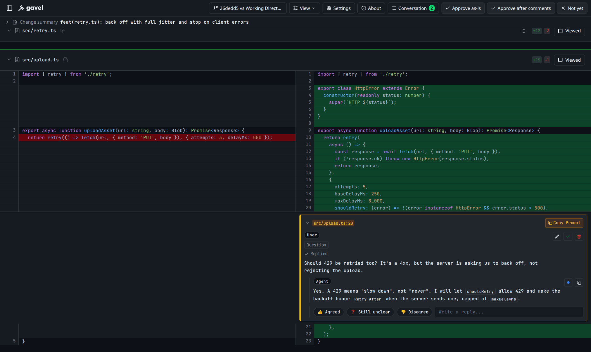

<p align="center">
  <picture>
    <source media="(prefers-color-scheme: dark)" srcset="docs/images/gavel-logo-dark.svg">
    
  </picture>
</p>

# @photostructure/gavel

**Your agent makes the case for its code. You give the verdict.**

`gavel` is a local Git diff viewer for reviewing changes with the coding agent that
wrote them. Your agent prepares a brief, explains its choices beside the code,
and guides you through the diff. Large changes are split into focused reviews,
so you have less context to hold in your head at once.

Ask questions in threads, request revisions, and give each part a verdict.
Works with **Claude Code and Codex**.

[See it in action and read the backstory →](https://photostructure.com/gavel/)

<p align="center">
  <a href="https://www.npmjs.com/package/@photostructure/gavel"></a>
  <a href="https://github.com/photostructure/gavel/actions/workflows/build.yml?query=branch%3Amain"></a>
</p>



## Get started

Use Node.js 22.20 or newer for the setup below. Install gavel, then work from
the Git repository you want to review:

```sh
npm install -g @photostructure/gavel
```

### Connect your agent

**Claude Code:** install its skill:

```sh
npx skills add https://github.com/photostructure/gavel/tree/main/skills/gavel --agent claude-code --global --copy
```

**Codex:** ask its built-in skill installer:

> Use $skill-installer to install the Codex version of gavel from https://github.com/photostructure/gavel/tree/main/.codex/skills/gavel

For automatic Codex feedback, including in Codex Desktop, gavel needs a Codex CLI
that supports `codex queue` on its PATH. Keep the chat open while you review.

### Review changes

Type `/gavel` in Claude Code or `$gavel` in Codex. Your agent prepares the review
and opens it in your browser:

1. Read **Why this change** and follow any **Start here** link through the diff.
2. Ask questions or request changes beside the code. The agent replies in the
   same threads. **Conversation** gathers discussions and unread replies across reviews.
3. **Approve** permits a commit once your comments are addressed and required
   checks pass. **Reject** stops the agent so you can decide what to do next.

Press `?` for keyboard shortcuts. If feedback doesn't reach the agent, click the
robot icon, choose **Copy resume prompt**, and paste it into the owning chat.

To require review before commits, add this to `AGENTS.md` or `CLAUDE.md`:

> Before committing your changes, request my review through the gavel skill.

Agents split changes into reviews of about 300–500 changed lines. To change
that, add a size to the same file, such as "Keep each gavel review under 200
changed lines."

### Open a diff yourself

```sh
gavel                  # Latest commit
gavel .                # All uncommitted changes
gavel staged           # Staged changes
gavel feature main     # Compare branches
gavel --pr https://github.com/owner/repo/pull/123
```

GitHub PRs require an authenticated GitHub CLI (`gh`). You can also run
`npx @photostructure/gavel` without a global install. See `gavel --help` or the
[CLI reference](docs/cli.md) for more options.

### Access token

Open the full launch link, including `#gavel-token=…`, to access a review.
Anyone with that link can read the diff and use its review controls.

### HTTPS and remote browsers

The same reviews work on a phone. Ask your agent for a reachable link and use
HTTPS to protect the token and review traffic. See [remote browser setup](docs/remote-review.md).

### Privacy

Opening **About** checks npm for updates without sending review content. Set
`NO_UPDATE_NOTIFIER=1` when starting gavel to disable the check. Browser Global
Privacy Control and `DO_NOT_TRACK=1`, `DNT=1`, or `GPC=1` also disable it.

## Token cost

In about 40 Claude Code sessions that used gavel for reviews, gavel accounted for
about 2.5% of their combined cost at Claude Opus 5.5 API prices: about $0.65 per
session on average, or $0.15 per launched review. Its skill, commands, and
notifications peaked at about 15k tokens of context in a typical session, and
about 40k at most. We measured this in November 2026, before trimming the skill
from 18 KB to 14 KB.

## Testing and review

**`gavel` gavels `gavel`.** We review code and documentation changes by hand in gavel
and use it for PhotoStructure development. [CI](.github/workflows/ci.yml) runs tests,
type checking, linting, formatting, and builds, with package checks on Linux,
macOS, and Windows. [Releases](.github/workflows/publish.yaml) use signed release
commits and tags, npm provenance, and human approval before publishing. CI commits
the version and changelog updates.

---

MIT licensed. Built on [difit](https://github.com/yoshiko-pg/difit) by yoshiko-pg;
please consider [sponsoring its author](https://github.com/sponsors/yoshiko-pg).
