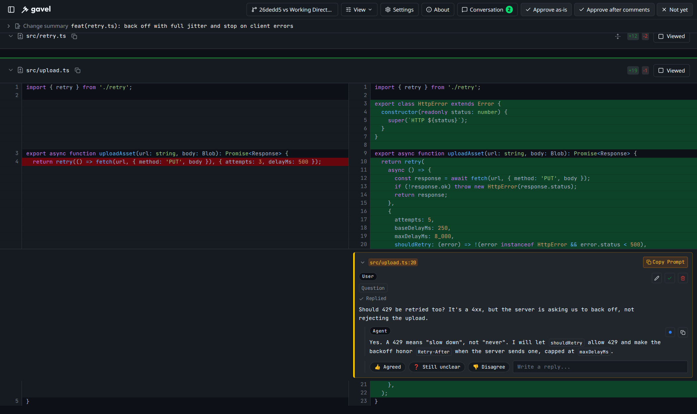
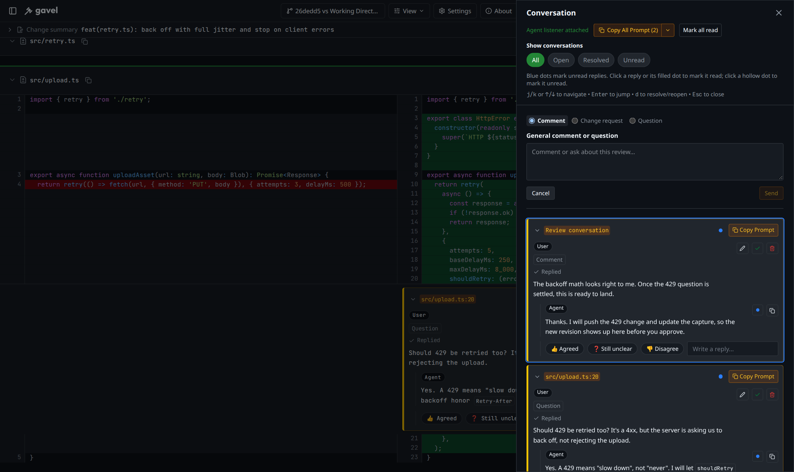

<p align="center">
  <picture>
    <source media="(prefers-color-scheme: dark)" srcset="docs/images/gavel-logo-dark.svg">
    
  </picture>
</p>

# @photostructure/gavel

**Your agent writes the code. You give the verdict.**

gavel is a local Git diff viewer for reviewing your coding agent's changes.
The agent prepares a summary, proposed commit message, and inline notes that
explain where to start and what deserves a closer look. Discuss the code in
threads beside the diff, then approve the change or request revisions. Works
with Claude Code and Codex.

<p align="center">
  <a href="https://www.npmjs.com/package/@photostructure/gavel"></a>
</p>



## ⚡ Quick Start

gavel needs Node.js 22.14 or newer. Run it from your Git repository to view the
latest commit:

```sh
npx @photostructure/gavel
```

Install it to use the `gavel` command:

```sh
npm install -g @photostructure/gavel
gavel
```

Connect your coding agent:

```sh
npx skills add photostructure/gavel
```

For Codex, follow the [Codex setup guide](docs/codex-review-integration.md#install-the-codex-entry-point)
to install its version of the skill. Then tell your agent:

> Open your changes in gavel for my review.

To make review part of your usual workflow, add this to your `AGENTS.md` or
`CLAUDE.md`:

> Request my review through gavel after you change code.

The viewer does not start an agent. The skill tells your existing agent how to
prepare a review and handle feedback; see [Calling from Agents](#-calling-from-agents)
for the Claude Code and Codex workflows.

## Review your agent's changes

### Read the summary and reading guide

Expand **Change summary** to see why the agent made the change and the commit
message it proposes. Both fields are editable.

Before opening the review, the skill tells the agent to comment on its own diff:
where to start and why tricky or odd-looking lines are written that way. Reply
to those notes like any other thread.

### Discuss the code where it changes

Mark each line comment as a **Comment**, **Change request**, or **Question** to
tell the agent whether to take note, revise the code, or explain something. The
agent replies in the same thread when it handles your feedback. **Read**,
**Thinking**, and **Replied** show the progress it reports; **Noted** means it
acknowledged the comment without a reply. Follow up with another message or
choose **Agreed**, **Still unclear**, or **Disagree**.

Use **Conversation** for questions about the whole change. It shows those
discussions alongside inline threads, with **All**, **Open**, **Resolved**, and
**Unread** filters. You can resolve or reopen a thread without losing its history.

### Give a verdict on each proposed commit

- **Approve as-is** gives the agent permission to commit the reviewed change.
- **Approve after comments** gives it permission to commit once it has addressed
  your comments.
- **Not yet** asks it to revise the change and bring it back for review.

The agent still has to run the required checks before committing. Each review
starts without a verdict, and you can change or clear it until the agent acts on
it. Click the selected verdict again, or choose **Clear verdict** in the menu.

When the agent proposes several commits, it creates the reviews in commit order.
Each gets a tab with its own message and verdict, so you can approve some changes
while asking for revisions to others. [Named reviews](#named-reviews-of-uncommitted-changes)
keep the captured diff fixed while you review it.

Conversations and verdict buttons are enabled by default. Use `--no-lgtm` to hide
approval controls, and `--no-jsonl --no-conversation` to disable conversations.
`--lgtm` and `--ship-it` are aliases.

### Review from your phone

The diff, threads, and verdict menu also work on a phone. gavel has no login of
its own: before accessing a review from another device, put it behind an
authenticated HTTPS proxy or tunnel. See [HTTPS and remote browsers](#https-and-remote-browsers)
for setup instructions.

## 🚀 Usage

### Basic Usage

```bash
gavel <target>                    # View single commit diff
gavel <target> [compare-with]     # Compare two commits/branches
```

### Single commit review

```bash
gavel          # HEAD (latest) commit
gavel 6f4a9b7  # Specific commit
gavel feature  # Latest commit on feature branch
```

### Compare two commits

```bash
gavel @ main         # Compare with main branch (@ is alias for HEAD)
gavel feature main   # Compare branches
gavel . origin/main  # Compare working directory with remote main
```

### Special Arguments

gavel supports special keywords for common diff scenarios:

```bash
gavel .        # All uncommitted changes (staging area + unstaged)
gavel staged   # Staging area changes
gavel working  # Unstaged changes only
```

### Named reviews of uncommitted changes

Use one review name per task. Repeat `--pathspec` for native Git filters and
exclusions; add `--include-untracked` when needed:

```sh
gavel --review parser-fix --pathspec src --pathspec ':(exclude)src/generated/**' --keep-alive
```

For a subset of changes in the same file, save a capture and use its printed
file/hunk IDs (replace the placeholder with an ID from that exact artifact):

```sh
gavel review capture --pathspec src --output /tmp/capture.json
gavel --review parser-subset --capture /tmp/capture.json --select '<hunk-id>' --keep-alive
```

Use the actual API port from `server.ready` to add another task or explicitly
replace a capture. Read `GET /api/reviews/parser-fix` for its current version
before updating:

```sh
gavel review create docs-update --port 4966 --pathspec docs
gavel review update parser-fix --port 4966 --expected-version 1 --pathspec src --pathspec ':(exclude)src/generated/**'
```

A review asks for approval when it carries a capture or a proposed commit message.
A message gavel copied from a browsed commit is not a proposal, and after a
commit moves HEAD only the newest unnamed review of uncommitted changes counts.
A different base browsed for uncommitted changes before an agent proposes makes
a newer review that hides the proposal's tab; that is unsupported. While any review on the server asks for approval, approved or
not, the header shows the open review's name in place of the review picker, and a
row of tabs under the header shows every such review in creation order with its
verdict and counts how many still need one, so a stack of commits can
be reviewed one after another in one browser tab. The tabs are hidden only when
the open review is the sole one. When they don't fit on one row, they collapse
into a menu on the open review's tab.

Captures read the index and working tree without changing them. Source edits and
browser refresh leave a named capture fixed. Updating to a changed patch retains
the conversation and proposal, advances its version, and revokes LGTM; stale
updates fail. Identical patches preserve the version and approval. Reviews are
saved under `.git/gavel`, so a restarted server that opens the same name and
patch, or the same commits, restores its comments, proposal and approval, and
`gavel approval status <commit>` reports a commit's saved approvals without a
server; reviews untouched for 7 days are deleted. Path filters can include other tasks'
changes; inspect the patch before asking for approval. See the
[capture and approval protocol](docs/agent-conversations.md#named-captures-for-uncommitted-work).

### GitHub PR

```bash
gavel --pr https://github.com/owner/repo/pull/123
```

`--pr` mode fetches patches by running `gh pr diff --patch` under the hood.
It also imports unresolved inline review threads from the PR so they appear as startup comments in gavel.

Authentication is handled by GitHub CLI:

1. **Login once** (recommended): `gh auth login`
2. **Token-based auth** (CI/non-interactive): set `GH_TOKEN` or `GITHUB_TOKEN`

#### GitHub Enterprise Server

For Enterprise Server PRs, authenticate GitHub CLI against your Enterprise host:

1. `gh auth login --hostname YOUR-ENTERPRISE-SERVER`
2. Or set `GH_HOST=YOUR-ENTERPRISE-SERVER` with `GH_TOKEN`/`GITHUB_TOKEN`

### Initial Comments

You can inject initial review comments when launching gavel:

```bash
gavel --comment '{"type":"thread","filePath":"src/example.ts","position":{"side":"new","line":10},"body":"The background for this change is..."}'
```

`--comment` is repeatable and accepts either a single JSON object or a JSON array. Supported types:

- `thread`: create a new thread at the specified diff position
- `reply`: add a reply to the latest existing thread at the same diff position

If the same comment already exists, gavel skips importing it.

### Stdin

By using a pipe to pass unified diffs via stdin, you can view diffs from any tool with gavel.

```bash
# View diffs from other tools
diff -u file1.txt file2.txt | gavel

# Review saved patches
cat changes.patch | gavel

# Compare against merge base
git diff --merge-base main feature | gavel

# Review an entire existing file as newly added
git diff -- /dev/null path/to/file | gavel

# Explicit stdin mode
git diff --cached | gavel -
```

Stdin mode is selected with intent-first rules:

- `-` explicitly enables stdin mode
- If positional arguments (`<target>` / `[compare-with]`) or `--pr` are provided, gavel treats the command as Git/PR mode and does not auto-read stdin
- Auto stdin detection applies only when no explicit mode is selected and stdin is a pipe/file/socket

## ⚙️ CLI Options

| Flag                          | Default         | Description                                                                                             |
| ----------------------------- | --------------- | ------------------------------------------------------------------------------------------------------- |
| `<target>`                    | HEAD            | Commit hash, tag, HEAD~n, branch, or special arguments                                                  |
| `[compare-with]`              | -               | Optional second commit to compare with (shows diff between the two)                                     |
| `--merge-base`                | false           | Resolve the base revision with `git merge-base` before diffing (Git revision mode only)                 |
| `--review <name>`             | -               | Capture uncommitted changes under a stable task name                                                    |
| `--pathspec <git-pathspec>`   | -               | Filter a native named capture with repeatable Git pathspecs, including exclusions                       |
| `--capture <file>`            | -               | Load an immutable capture artifact for a named review                                                   |
| `--select <file-or-hunk-id>`  | -               | Select exact file/hunk IDs from a capture; repeatable                                                   |
| `--pr <url>`                  | -               | GitHub PR URL to review (e.g., https://github.com/owner/repo/pull/123)                                  |
| `--comment <json>`            | -               | Inject initial comments (repeatable; accepts a JSON object or array)                                    |
| `--commit-message <text>`     | -               | Seed the proposed commit message for the initial review                                                 |
| `--why <text>`                | -               | Seed the rationale for the initial review                                                               |
| `--port`                      | 4966            | Preferred port; falls back to +1 if occupied                                                            |
| `--host`                      | 127.0.0.1       | Host address to bind server to (use 0.0.0.0 for external access)                                        |
| `--no-open`                   | false           | Don't automatically open browser                                                                        |
| `--clean`                     | false           | Clear all existing comments and viewed files on startup                                                 |
| `--lgtm, --ship-it`           | true            | Show the LGTM toggle to grant or revoke approval while the review stays open                            |
| `--conversation`              | true            | Enable conversation APIs (exact-thread replies, progress receipts, snapshots); required by `--jsonl`    |
| `--include-untracked`         | false           | Include untracked files with `.`, `working`, or a native named capture                                  |
| `--keep-alive`                | false           | Keep server running after browser disconnects (stop manually with Ctrl+C)                               |
| `--jsonl`                     | true            | Emit JSON Lines on foreground stdout; diagnostics go to stderr                                          |
| `--no-jsonl`                  | false           | Use human-readable foreground output                                                                    |
| `--background`                | false           | Detach the server and output connection information; no live stdout stream                              |
| `--context <lines>`           | git default (3) | Limit surrounding context lines per change (`0` shows changes only; not available with `--pr` or stdin) |
| `--title <title>`             | -               | Custom browser tab title, to tell review sessions apart when several gavel instances are open           |
| `--agent <name>`              | detected        | Agent shown under **About**: `$CLAUDE_CODE_ENTRYPOINT`, the Codex rollout `originator`, or `$AI_AGENT`  |
| `--agent-session-name <name>` | -               | Name of the agent session that launched the review, shown under **About**                               |
| `--agent-session-id <id>`     | detected        | Agent session ID shown under **About**; `$CLAUDE_CODE_SESSION_ID` or `$CODEX_THREAD_ID`                 |

### Open in editor

Set the editor before starting gavel. The server chooses the executable and
arguments; the browser sends the selected file, line, and a session credential. `GAVEL_EDITOR`
accepts `vscode` (default), `cursor`, `zed`, `textmate`, `bbedit`, `emacs`,
`macvim`, `sublime`, `nova`, `custom`, or `none`. If `GAVEL_EDITOR` is unset,
gavel checks `EDITOR` for one of these preset names. Use `none` to hide the
button. Open in editor is unavailable for stdin diffs.

```sh
GAVEL_EDITOR=cursor gavel .
GAVEL_EDITOR=custom GAVEL_EDITOR_COMMAND=emacsclient \
  GAVEL_EDITOR_ARGS='--no-wait +%line %file' gavel .
```

For `custom`, set both `GAVEL_EDITOR_COMMAND` and `GAVEL_EDITOR_ARGS`. The
template must pass `%file` or `%file:%line` as a separate argument; `%line` is replaced with the
selected line. `%file` becomes the absolute repository file path. Arguments are
passed directly to the executable without a shell. Restart gavel to change the
editor.
Use the full URL printed by gavel when opening a review manually; its fragment
authorizes editor launches for that server session.

## 💬 Comment System

gavel includes a review comment system that makes it easy to provide feedback to AI coding agents:

1. **Add Comments**: Click the comment button on any diff line or drag to select a range
2. **Edit Comments**: Edit existing comments with the edit button
3. **Generate Prompts**: Comments include a "Copy Prompt" button that formats the context for AI coding agents
4. **Copy All**: Use "Copy All Prompt" to copy all comments in a structured format
5. **Persistent Storage**: Comments are saved in browser localStorage per commit
6. **Unsent drafts**: Text typed into a line comment, a reply, or an edit is saved in the
   tab's sessionStorage per review, so after a reload, or after switching to another review
   and back, the form reopens with the text, and a file holding a draft opens even if it is
   marked viewed. A draft whose line the diff no longer shows appears at the top of its
   file. Only Send or **Cancel** deletes unsent text; Escape never does. In the diff,
   Escape closes a form only when nothing in it is unsaved (an empty comment or reply, or
   an edit you have not changed) and otherwise leaves it open. **Conversation** lists every unsent draft under **Unsent drafts**, including
   drafts on files no longer in the diff, and a pencil badge on the button counts them; a
   line draft there can be edited and sent in place. The list is taken when the panel
   opens, so a reply started in the panel joins it the next time. In **Conversation**,
   Escape in a form that holds text closes the panel and keeps the text, the general
   comment included.

### Compact review controls

The header keeps the current review, **View**, **Settings**, **About**, **Conversation**,
and approval together. The review picker switches comparisons and shows capture details;
while any review asks for approval, the header shows the open review's name instead and
the review tabs switch reviews.
**About** opens agent, session, repository, and server information in a right-side panel.
**View** switches between Split and Unified and toggles whitespace. The gear button
opens **Settings** for font size, font family, theme, syntax theme, color vision,
approval animations, and auto-viewed patterns. Each browser keeps its own settings in a
cookie, so a tablet and a desktop can use different font sizes; auto-viewed patterns
are saved in `~/.gavel/config.json` and shared by every browser. Below 1024px wide,
the review picker, **View**, **Settings**, **About**, and **Conversation** show only
their icons, and the review picker's menu names the comparison. Below 1280px the three
verdict buttons become one menu that shows the current verdict. Below 768px the header
also drops the gavel logo and shows the unread-reply count on the corner of
**Conversation**. The files-viewed count is in the file tree, not the header. On phones and tablets in either orientation, and
in windows 500px tall or less, the header, review tabs, and **Change summary** slide out of
view while the diff scrolls down and return on scroll up or when keyboard focus moves into
them, and file headers use less padding. Copy-all and agent
resume actions live in **Conversation**; file-view progress sits above the file list.

The verdict buttons offer **Approve as-is**, **Approve after comments are addressed**, and
**Not yet**. Conditional approval stays pending until every recorded comment revision
has completion evidence or is confirmed by the reviewer. **Not yet** sends the review back
for revision. After any verdict, a notice under the verdict buttons counts down ten seconds,
then opens the next review without one, or closes the tab once every review has one;
**Switch now** or **Close now** skips the wait, and **Cancel** stops it.
When the browser refuses to close the tab, gavel says it can be closed. While a review
lacks a verdict, its tab pulses after a verdict elsewhere, and leaving the page asks first.
See [approval modes](docs/approval-modes.md) for
agent commands, capture guards, and the meaning of the output fields.

### Review-wide conversations

Open **Conversation** in the header to see the review's discussions in a side panel.



The **Conversation** button shows a badge counting unread agent messages.
Inside the panel, use the **All**, **Open**, **Resolved**, and **Unread** filter pills.
Blue dots identify threads with unread agent replies, including resolved and
outdated threads; select a dot to jump to the first unread message.
Click an agent reply to mark only that reply read, or use the dot at the start of
its action buttons: a filled dot marks it read, a hollow ring marks it unread.
**Mark all read** marks every agent message in the review,
including threads hidden by the current filter. Opening, scrolling, jumping to a
reply, and closing the panel never mark replies read. The same explicit controls
appear on inline agent replies.
Read state is saved in this browser for each review and message revision;
edited replies become unread again. This is separate from agent delivery
receipts and thread resolution.

Start a general discussion in **Conversation** when feedback applies to the whole review rather
than one line. General threads support replies, editing, and Copy Prompt just like
inline threads, and are saved with the selected comparison. Click an inline thread
to jump to its code; general threads stay in the panel. Copy All and CLI comment
output include both kinds of discussion.

When the newest message in a thread is an agent reply, the thread offers quick
replies beside **Write a reply...**: **👍 Agreed** sends "👍 Agreed: no reply
needed." as a Comment, **❓ Still unclear** asks for another explanation, and
**👎 Disagree** asks the agent to reconsider or defend its point; both of those are
Questions. Each is an ordinary reply, so it shows delivery progress and can be
deleted. **Write a reply...** opens the full form; Escape or a click elsewhere
closes it while it is empty, and **Cancel** discards a draft. Every comment form
has **Cancel** at the opposite end of the row from **Send** (**Save** when
editing a comment).

### Comment Prompt Format

```sh
src/components/Button.tsx:L42   # This line is automatically added
Make this variable name more descriptive
```

For range selections:

```sh
src/components/Button.tsx:L42-L48   # This line is automatically added
This section is unnecessary
```

## 🤖 Calling from Agents

The `gavel` skill prepares the summary, proposed commit message, and reading-guide
comments, starts the review, and handles your feedback. Use it when you ask for
gavel explicitly, or add a standing review instruction as shown in
[Quick Start](#-quick-start).

The workflow depends on the agent's host:

- **Claude Code** uses `gavel wait` when its host supports background commands
  without a time limit and resumes the agent when they finish. It reads your
  feedback and replies while you keep reviewing. One wait command can cover
  several gavel servers. In other hosts, the skill tells Claude to end its turn
  and have you resume it through chat.
- **Codex** ends its turn while you review. After leaving feedback, open
  **Conversation**, click **Copy resume prompt**, and paste it into the Codex chat. Codex reads a snapshot
  of the review, handles your feedback, and ends its turn again. A separately
  configured external controller can deliver feedback automatically. See the
  [installation and handoff guide](docs/codex-review-integration.md); keep
  Codex's installed skill target separate from Claude's.

### Stay idle while you review

Repeatedly asking a model to check for feedback uses tokens even when nothing has
changed. The skills tell the agent to stay idle until there is something to do.
`gavel wait` has no overall timeout; empty responses and the agent's own activity
produce no output. With no pending feedback and no reviewer connected to any
watched server, it exits with code 4 and the agent ends its turn. With the default
Codex setup, use the chat handoff described above.

Before opening a review you did not explicitly request, the agent runs
`gavel idle` to check the time since your last keyboard or mouse input. If you
have been away for at least 10 minutes, or it cannot read your input activity,
it finishes its other work and leaves a note that the change is ready for review.

See [waiting for review](docs/waiting-for-review.md) for host requirements and
[Agent conversations](#agent-conversations) for the CLI protocol.

## 🎨 Syntax Highlighting Languages

- **JavaScript/TypeScript**: `.js`, `.jsx`, `.ts`, `.tsx`, `.svelte`
- **Web Technologies**: HTML, CSS, JSON, XML, Markdown
- **Shell Scripts**: `.sh`, `.bash`, `.zsh`, `.fish`
- **Backend Languages**: PHP, SQL, Ruby, Java, Groovy, Scala, Perl, Elixir, Haskell, Clojure
- **Systems Languages**: C, C++, C#, Rust, Go
- **Mobile Languages**: Swift, Kotlin, Dart
- **Infrastructure as Code**: Terraform (HCL), Nix
- **Others**: Python, Protobuf, GraphQL, YAML, Solidity, Vim script, GDScript

## 🔍 Auto-collapsed Files

gavel automatically identifies and collapses certain files to keep your view clean:

- **Deleted files**: Removed files are auto-collapsed since they don't require close review
- **Generated files**: Auto-generated code is collapsed by default. This includes:
  - Lock files (`package-lock.json`, `go.sum`, `Cargo.lock`, `Gemfile.lock`, etc.)
  - Minified files (`*.min.js`, `*.min.css`)
  - Source maps (`*.map`)
  - Generated code:
    - Orval (`*.msw.ts`, `*.zod.ts`, `*.api.ts`)
    - Dart (`*.g.dart`, `*.freezed.dart`)
    - C# (`*.g.cs`, `*.designer.cs`)
    - Protobuf (`*.pb.go`, `*.pb.cc`, `*.pb.h`)
  - Frameworks:
    - Ruby on Rails (`db/schema.rb`)
    - Laravel (`_ide_helper.php`)
    - Gradle (`gradle.lockfile`)
    - Python (`uv.lock`, `pdm.lock`)
  - Generic generated files (`*.generated.cs`, `*.generated.ts`, `*.generated.js`)
  - Content-based detection:
    - Files containing `@generated` marker
    - Files containing `DO NOT EDIT` header
    - Language-specific generated headers (Go, Python, etc.)

## Agent conversations

Discover the JSON contract with `gavel schema [events|summary|reply|status|snapshot|comments|import|approval]`.
Use `gavel schema capture` for saved artifacts and `gavel schema capture-update`
for guarded updates. Without a selector, the Draft 2020-12 bundle describes launch events; `$defs` also
includes agent requests and responses. Use `gavel comment <command> --help` for
usage. The commit message is `commitMessage` and its TLDR is `rationale` in the
summary payload; comments and replies also use JSON.

Seed editable review intent with
`gavel --review parser-fix --commit-message 'fix: preserve review intent' --why 'Explain why the change is needed.'`.
Each diff selection keeps its own proposed message and rationale for the server's
lifetime. Saving a change revokes that selection's LGTM approval. Agents can update
the same fields with `gavel comment summary --port <port> < /tmp/gavel-summary.json`;
see the [proposal protocol](docs/agent-conversations.md#proposed-commit-message-and-rationale).

Use `gavel <target> <base> --keep-alive` to let an agent answer comments while
you continue reviewing. Foreground stdout emits JSON Lines by default; diagnostics
go to stderr. `--jsonl` is explicit and `--no-jsonl` selects human output while
retaining control APIs. In human mode, startup diagnostics still go to stderr;
comment and approval output goes to stdout. To disable conversations, use
`--no-jsonl --no-conversation`.
Keep the process handle and read new output between tool steps. `server.ready` identifies
the actual API port, URL, PID, and review. Send replies and explicit Delivered/Read
receipts with `comment reply` and `comment status` using that API port.
`--background` has no live stdout. Use `gavel wait --port <port>` to wait silently
for human activity on an existing server. Repeat `--port` to cover several servers
with one waiter. It has no overall timeout and exits with one nonempty JSON batch;
empty HTTP rounds and agent activity produce no output. Save each returned
`port`/`cursor` and supply `--after port=cursor` on the next invocation to cover
changes between waits. Queued messages are recovered on every attachment without
being acknowledged. Replay retains 256 events per server process; expired cursors
require explicit snapshot reconciliation. Use `gavel schema wait` for the result
contract. See [waiting for review](docs/waiting-for-review.md) and the
[conversation protocol](docs/agent-conversations.md), including conditional LGTM
approval.

The browser shows whether an agent listener is attached and offers **Copy resume
prompt** when one is absent. `gavel wait` requires presence reporting and exits 4
when no reviewer is connected on any selected server, after returning existing
human work. End the agent turn on that result instead of retrying. For Codex
desktop, the [integration guide](docs/codex-review-integration.md) describes ending
the turn during review and resuming from the copied prompt, with no idle model
turns. It also specifies an external-controller approach for automatic delivery.
Use an explicit `--host` for a server bound to a LAN interface; see
[server addresses](docs/server-addresses.md).

`gavel idle` prints `{"idleMs": …, "source": …}`: milliseconds since the desktop
user's last keyboard or mouse input, read over D-Bus on Linux (KDE's
`org.freedesktop.ScreenSaver` on X11, or GNOME's `org.gnome.Mutter.IdleMonitor`), from
`ioreg` on macOS, and from `GetLastInputInfo` on Windows. It exits 1 when no
source answers, including on KDE under Wayland, where KDE refuses the call as
not supported, and in a Windows ssh session, which has no input of its own.
Agents run it before opening a review to tell whether the user is at the desk.

## HTTPS and remote browsers

The browser's [Clipboard API](https://developer.mozilla.org/en-US/docs/Web/API/Clipboard/writeText)
requires a secure context. Localhost is treated as trustworthy for local development;
a remote HTTP address such as `http://10.1.1.24:4966` generally is not. gavel tries a
legacy copy fallback, but trusted HTTPS is the reliable setup for remote browsers.
Browser permissions can still prevent copying.

Start the built gavel server on the machine containing the repository:

```sh
gavel . --host localhost --port 4966 --no-open --keep-alive
```

Use the actual port printed at startup if 4966 is occupied. From a source checkout,
run `pnpm build`, then use `node dist/cli/index.js` in place of `gavel`.
Proxy this server, which serves both the UI and `/api`, at the root of one HTTPS
origin. The development server (`pnpm dev`, usually port 5173) can embed a localhost
API address for event streams, so it is not the target for these recipes.

The proxy must stream Server-Sent Events (SSE) on `/api/watch` and `/api/heartbeat`
without buffering or caching. `--keep-alive` prevents a dropped browser connection
from ending the review. gavel has no built-in login: anyone who can reach the
service can access the review and its enabled actions. Use an authenticated proxy
for private repositories; HTTPS alone does not restrict access.

### Cloudflare Tunnel (`cloudflared`)

For ongoing remote reviews, use a [named Cloudflare Tunnel](https://developers.cloudflare.com/tunnel/get-started/)
with a hostname such as `review.example.com`, routed to service type HTTP at
`localhost:4966`. Configure a Cloudflare Access policy for the intended reviewers
before exposing private code, and open the resulting HTTPS hostname. Keep `/api/*`
uncached and confirm live updates using the checks below.

For a temporary preview, an installed `cloudflared` can create a Quick Tunnel:

```sh
cloudflared tunnel --url http://localhost:4966
```

Open the HTTPS URL printed by the command. However, [Quick Tunnels do not support
SSE](https://developers.cloudflare.com/tunnel/get-started/quick-tunnels/), which
gavel uses for live updates. They are unsuitable for the full conversation workflow:
a page loading and Copy working do not establish that replies or approval changes
will update live. The URL is public unless access restrictions are configured.

### localtunnel

With [localtunnel](https://github.com/localtunnel/localtunnel), run a second process:

```sh
pnpm dlx localtunnel --port 4966 --local-host localhost
```

Open its printed HTTPS URL. This exposes the review through a third-party service;
use non-sensitive diffs for a public preview. Verify streaming replies and updates
before relying on a hosted tunnel for a review. Stop the tunnel when finished.

### local-ip.sh on a LAN

[local-ip.sh](https://local-ip.sh/) provides DNS names for IP addresses. For example,
`10-1-1-24.local-ip.sh` resolves to `10.1.1.24`. The reviewing device must be able to
reach that address; this does not create a tunnel or turn gavel's HTTP server into
an HTTPS server.

Run a TLS reverse proxy on the repository machine. For example, with Caddy installed,
use this `Caddyfile`, replacing the address with that machine's LAN IP:

```caddyfile
https://10-1-1-24.local-ip.sh:8443 {
    tls internal
    reverse_proxy localhost:4966
}
```

Run `caddy run --config Caddyfile`, allow the reviewing device to reach port 8443,
and open `https://10-1-1-24.local-ip.sh:8443`. Caddy's `tls internal` uses a local CA;
install and trust its root certificate on each reviewing device before using the
page. Alternatively, configure a certificate trusted by those devices with Caddy's
[`tls` directive](https://caddyserver.com/docs/caddyfile/directives/tls).
[Caddy streams SSE responses](https://caddyserver.com/docs/caddyfile/directives/reverse_proxy#streaming).

local-ip.sh also publishes a wildcard certificate and its private key. Because that
key is public, use your own certificate for private code. The hostname alone,
or bypassing a certificate warning, is not a substitute for trusted HTTPS.

### Check copying and live conversations

Open the HTTPS page without a certificate warning, click Copy Prompt, and paste
into a text editor. For conversations, start foreground gavel with `--keep-alive`
on the repository machine and retain its JSONL stdout. Submit a comment from the
remote browser, verify it appears in the launch output, then send a
[reply](docs/agent-conversations.md) and confirm it appears without refreshing.
Agent commands still connect to localhost on the repository machine; the browser
can use the HTTPS proxy. They do not acquire remote-host support from the URL.

## 🛠️ Development

```bash
# Install dependencies
pnpm install

# Start development server (with hot reload)
# This runs both Vite dev server and CLI with NODE_ENV=development
pnpm run dev

# Build and start production server
pnpm run start <target>

# Build for production
pnpm run build

# Run tests
pnpm test

# Run typecheck, lint, and format
pnpm run check
pnpm run format
```

### Development Workflow

- **`pnpm run dev`**: Starts both Vite dev server (with hot reload) and CLI server simultaneously
- **`pnpm run start <target>`**: Builds everything and starts production server (for testing final build)
- **Development mode**: Uses Vite's dev server for hot reload and fast development
- **Production mode**: Serves built static files (used by npx and production builds)

## 🏗️ Architecture

- **CLI**: Commander.js for argument parsing with comprehensive validation
- **Backend**: Express server with simple-git for diff processing
- **GitHub Integration**: GitHub CLI (`gh pr diff --patch`) for PR patch retrieval
- **Frontend**: React 18 + TypeScript + Vite
- **Styling**: Tailwind CSS v4 with GitHub-like dark theme
- **Syntax Highlighting**: Prism.js with dynamic language loading
- **Testing**: Vitest for unit tests with co-located test files
- **Quality**: oxlint and oxfmt

## 📋 Requirements

- Node.js ≥ 22.14.0
- Git repository with commits to review
- GitHub CLI (`gh`) for `--pr` mode

## Built on difit

gavel started as PhotoStructure's fork of [difit](https://github.com/yoshiko-pg/difit),
yoshiko-pg's GitHub-style diff viewer. If gavel is useful to you, please consider
[sponsoring yoshiko-pg](https://github.com/sponsors/yoshiko-pg).

The question marker and explicit thread deletion incorporate
[upstream PR #482](https://github.com/yoshiko-pg/difit/pull/482).

## 📄 License

MIT

The optional `--ship-it` button uses a user-supplied LGTM screenshot from
[this video](https://www.youtube.com/watch?v=3TNpOD6bov8). The image belongs to
its respective rights holders and is not covered by this project's MIT license.
